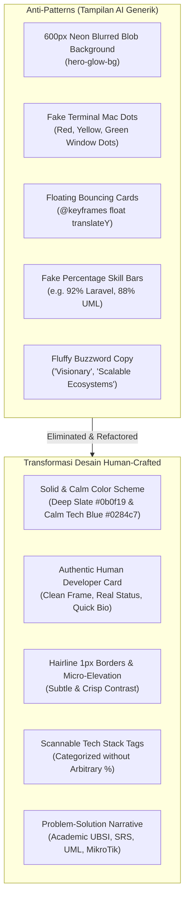

# Audit & Transformasi Desain Portofolio: Human-Crafted Engineering vs. AI Cliches

> **Target Kandidat:** Andika Amansyah  
> **Profil:** Mahasiswa S1 Teknologi Informasi Universitas Bina Sarana Informatika (UBSI), IPK 3.85 / 4.00  
> **Fokus Karir:** Junior Web Developer (Laravel/PHP/MySQL), System Analyst, & Network Infrastructure  
> **Live Production:** [https://portfolio-andika-theta.vercel.app](https://portfolio-andika-theta.vercel.app)  
> **Repository:** [https://github.com/AlexanderFarhan/portfolio-andika](https://github.com/AlexanderFarhan/portfolio-andika)

---

## 1. Analisis Masalah: Mengapa Tampilan Sebelumnya Terlihat Seperti "Buatan AI"?

Sebelum perubahan dilakukan, website portofolio memiliki sejumlah **"AI-isms" visual & struktural** yang sering dihasilkan oleh generator template instan. Bagi Engineering Manager dan HR Recruiter, elemen-elemen ini sering dianggap sebagai *red flag* karena terkesan generik, tanpa rasa kepemilikan pribadi (craftsmanship), dan melebih-lebihkan kompetensi:

### Daftar AI Tells yang Dieliminasi:

1. **Fake macOS Terminal Window Dots (`dot-red`, `dot-yellow`, `dot-green`)**:
   - *Masalah:* Template AI selalu menambahkan kartu kode palsu (`candidate-summary.json`) dengan tiga titik jendela Mac palsu dan label `READY_TO_HIRE`. Elemen ini sangat klise dan tidak mencerminkan lingkungan kerja nyata.
   - *Solusi:* Digantikan dengan **kartu identitas developer yang elegan & jujur** berisi frame foto profil berbingkai subtle 1px, badge status akademik nyata (*"Mahasiswa Aktif S1 TI UBSI (Semester 6)"*), dan ringkasan stack inti.
2. **Neon Gradient Blob / Glow Background (`hero-glow-bg`)**:
   - *Masalah:* Efek radial glow ungu/cyan berukuran 600px dengan blur ekstrem (`filter: blur(120px)`) khas landing page AI crypto/SaaS.
   - *Solusi:* Latar belakang dibersihkan menjadi kanvas solid yang tenang (`#0b0f19` pada dark mode dan `#f8fafc` pada light mode) dengan grid hairline aksen yang rapi dan tidak mengaburkan teks.
3. **Floating Bouncing Badges (`@keyframes float`)**:
   - *Masalah:* Elemen kartu melayang-layang naik turun tanpa interaksi pengguna, mengalihkan fokus pembaca dan membebani rendering GPU mobile.
   - *Solusi:* Posisi statis dengan micro-interaction berbasis aksi pengguna (`:hover` translateY -3px yang halus dan cepat).
4. **Persentase Keahlian Arbitrer (misal: "Laravel 92%", "UML 88%")**:
   - *Masalah:* Tidak ada recruiter atau tech lead yang percaya pada metrik persentase skill ("Apa bedanya bisa Laravel 92% dengan 95%?"). Ini adalah penanda klasik template portofolio AI.
   - *Solusi:* Dikonversi menjadi **kelompok kompetensi modular berbasis peran** (*Web Development, System Analysis & Architecture, Networking & Infrastructure, IoT & Hardware*) yang didukung oleh daftar tools nyata yang dikuasai.
5. **Gaya Bahasa Buzzword Korporat**:
   - *Masalah:* Kalimat seperti *"Crafting future-ready synergistic digital experiences"*.
   - *Solusi:* Ditulis ulang dengan **sudut pandang orang pertama (first-person voice) yang lugas, rendah hati, namun berbobot**: menceritakan fondasi dari SMK TKJ hingga S1 UBSI, kebiasaan membuat SRS/UML/ERD sebelum coding, serta pengalaman konfigurasi routing MikroTik dan mikrokontroler ESP32.

---

## 2. Perubahan Desain & Hirarki Visual (Before vs After)

- **Header:** "Andika Amansyah" (Software Engineer & Analyst) dengan monogram profesional `AA` menggantikan "MyProto.A".
- **Hero Section:** Tipografi solid, layout dua kolom simetris, portrait card yang bersih dengan badge IPK 3.85.
- **Navigasi & Action:** Akses instan ke "Download CV (PDF)" dan navigasi anchor yang jelas ke setiap bagian.
- **Tombol:** Radius sudut konsisten (8px) dengan warna primer Tech Blue `#0284c7` yang grounded.
- **Keahlian:** 4 pilar kompetensi dengan badge badge-subtle yang scannable oleh HR/Recruiter.
- **Copy:** Narasi otentik tentang metodologi kerja (SRS -> UML -> ERD -> Code -> Test -> Deploy).

---

## 3. Peta Struktur Informasi Baru (Information Architecture)

Halaman utama dirancang untuk **memaksimalkan konversi rekruter** dalam 30 detik pertama:

| Urutan | Komponen | Tujuan Strategis bagi Rekruter |
| :--- | :--- | :--- |
| **1** | **Hero Section** | Menetapkan identitas kandidat dalam 5 detik: Mahasiswa TI UBSI (IPK 3.85), stack utama (Laravel, MySQL, MikroTik), dan CTA unduh CV / hubungi. |
| **2** | **Tentang Saya & Filosofi Rekayasa** | Membuktikan pola pikir struktural: mengapa Andika selalu memulai proyek dari analisis kebutuhan (SRS & UML) sebelum menulis baris kode pertama. |
| **3** | **Matriks Keahlian Teknis** | Menghilangkan progress bar palsu, menggantinya dengan taksonomi rapi: Web, Analisis Sistem, Jaringan, dan IoT. |
| **4** | **Studi Kasus Proyek Unggulan** | Setiap kartu memuat: Masalah yang dipecahkan, solusi arsitektur, tech stack yang dipakai, serta tautan langsung ke demo & GitHub. |
| **5** | **Pengalaman & Pendidikan Formal** | Menunjukkan rekam jejak konsisten dari SMK TKJ hingga kuliah S1 dengan IPK 3.85. |
| **6** | **Sertifikasi Resmi** | Verifikasi kredibilitas melalui sertifikat kompetensi BNSP, Dicoding, Cisco, atau lembaga terafiliasi. |
| **7** | **Form Kontak & Saluran Komunikasi** | Direct contact form yang terintegrasi dengan database PostgreSQL dan tombol instan WhatsApp. |

---

## 4. Kepatuhan Aksesibilitas (WCAG 2.1 AA) & Performa

Desain baru ini tidak hanya unggul secara visual, tetapi juga mematuhi prinsip aksesibilitas web profesional:

- **Color Contrast Ratio**: Kontras teks `#0f172a` (light mode) dan `#f1f5f9` (dark mode) terhadap background melampaui rasio minimum 4.5:1 untuk normal text dan 3:1 untuk large text.
- **Keyboard Navigation & Focus Indicator**: Semua link, tombol, dan form input memiliki `:focus-visible` styling (`outline: 2px solid #0284c7; outline-offset: 2px`) sehingga nyaman diakses via tombol Tab.
- **Semantic HTML5**: Menggunakan elemen `<header>`, `<nav>`, `<main>`, `<section>`, `<article>`, dan `<footer>` yang terbaca dengan sempurna oleh screen reader.
- **Lightweight Assets**: Vite 7 mengompilasi CSS bersih tanpa dependency font berlebih atau library animasi JavaScript berat.
